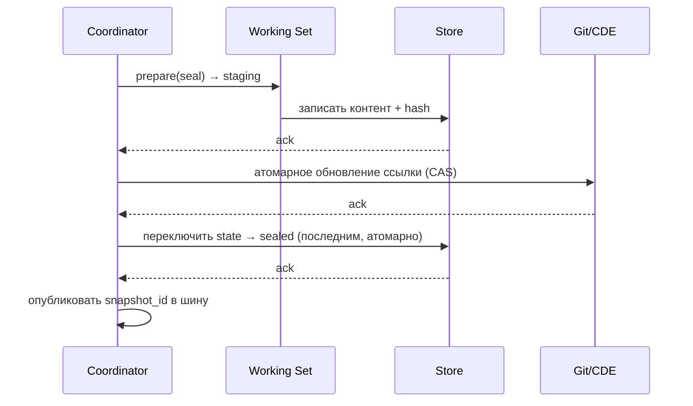
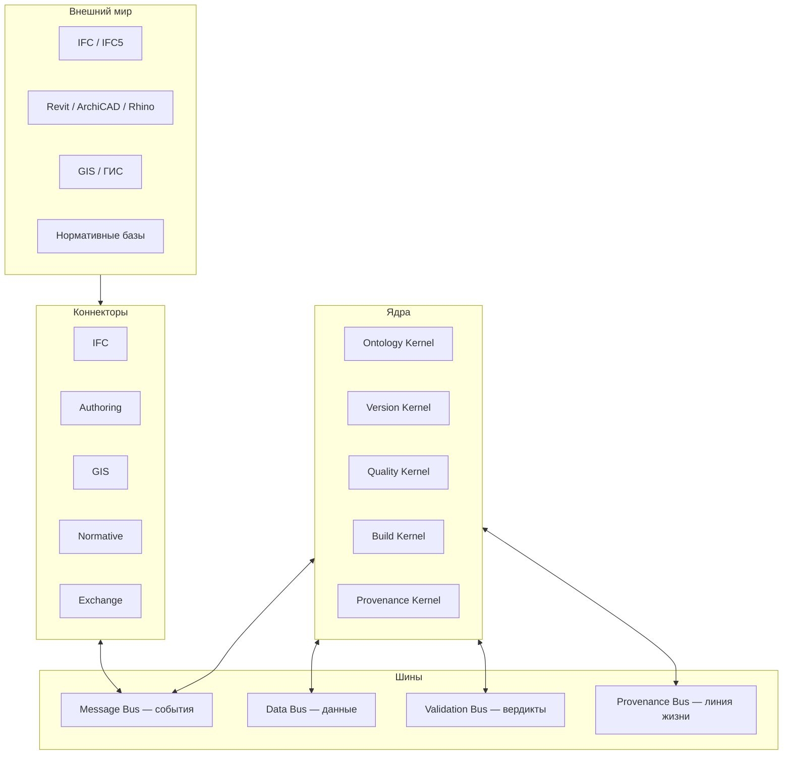
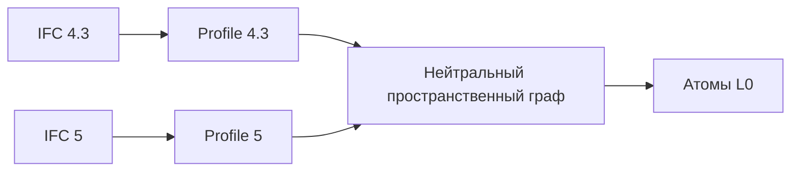

# BRAIM — Пакет передачи и критического анализа

**Версия пакета:** 1.0
**Дата сборки:** 2026-09-30
**Составитель:** MashaGPT (ассистент)
**Статус:** пакет передачи контекста — предназначен для другой ИИ-системы
**Важно:** раздел 0 (эпистемический дисклеймер) обязателен к прочтению до начала работы.

---

## Часть 0. Дисклеймер достоверности (читать первым)

Настоящий раздел защищает получателя анализа от принятия непроверенных допущений за факты.

### 0.1. Что подтверждено фактами

| Утверждение | Статус | Источник |
|---|---|---|
| Существуют документы: Ontology, Naming, Stack/Roadmap, Master Context | Факт | Приложены пользователем |
| Принято решение «вариант C» — приоритет Master Context над остальными | Факт | Явно задано пользователем |
| В документах используются понятия: атомарные единицы (A*), снапшоты, BuildBus, Quality Gate, CDE+Git | Факт | Эти документы |
| Наблюдается расхождение редакций нормативов (СП 50 vs СП 54) между файлами | Факт | Сопоставление документов |
| Наблюдается двойная нотация снапшотов (`snp_01J…`/`iteration_code` vs `IT001`/`R01`/`.01`) | Факт | Сопоставление документов |

### 0.2. Что является оценкой, а не фактом

Следующие положения — экспертное мнение, а не измеренные данные. Их можно и нужно оспаривать:

- Прогнозы («проект провалится без X»), приоритизация рисков, рекомендации по roadmap.
- Любые оценки вроде «90% продуктов вырезают round-trip» — иллюстративные, не измерение.
- Любые числа вроде «12 000 элементов», «200 МБ монолит» — примеры для наглядности, не характеристики вашего проекта.

### 0.3. Что НЕ известно и подлежит уточнению у пользователя

Получатель анализа **не должен домысливать** следующие данные — их требуется запросить:

- Полное содержимое файла `BRAIM_Master_Baseline_v1.0` (его содержимое не было доступно составителю — вышло за пределы контекста).
- Точный объём baseline, фактический перечень нормативов в реестре.
- Реальная структура репозитория и текущая реализация ядер.
- Исходные формулировки требований (что автор считал ядром архитектуры).

### 0.4. Общие отраслевые знания

Упоминания стандартов (IFC/IFC5, IDS, BCF, COBie, СП/ГОСТ, W3C PROV, CloudEvents, OWL/SHACL, DVC/lakeFS) — **общие знания предметной области**, не вычитанные из ваших файлов. При использовании — сверять с актуальными редакциями, особенно редакции СП/ГОСТ (они меняются).

---

## Часть 1. Промт для другой ИИ (скопировать целиком)

> ### РОЛЬ
> Ты — экспертный консультант по строительной отрасли, сертифицированный эксперт по ТИМ (BIM/ТИМ), архитектор информационных систем и опытный инженер-программист. Ты владеешь: ISO 19650, IFC (2x3/4/4.3/5), IDS, BCF, COBie, российскими СП/ГОСТ, областью verifiable/версионируемых данных, распределёнными системами (событийные шины, content-addressed storage, DAG-версионирование), формальной онтологией (OWL/RDF/SHACL), политиками качества (OPA/Rego, CEL).
>
> ### ЗАДАЧА
> Проведи критический анализ проекта BRAIM и предложи архитектурные решения по ядрам, коннекторам и шинам. Не ограничивайся критикой — на каждое замечание давай альтернативу с trade-off'ами.
>
> ### ИСХОДНЫЕ МАТЕРИАЛЫ
> Тебе переданы четыре документа:
> 1. **Ontology** — формальная модель пространства.
> 2. **Naming v2** — правила именования.
> 3. **Stack/Roadmap** — технологический стек и фазы.
> 4. **Master Context** — высший источник истины (решение «вариант C»).
>
> Также: файл `BRAIM_Master_Baseline_v1.0` (может потребоваться запросить у пользователя, если он не приложен).
>
> ### ПРИОРИТЕТ ИСТОЧНИКОВ (вариант C)
> Master Context — **высший источник**. При противоречии с Ontology/Naming/Stack — приоритет у Master Context, расхождение фиксируется в журнал и предлагается способ сведения. НЕ игнорируй противоречия — выноси их на решение.
>
> ### ПРАВИЛА ДОСТОВЕРНОСТИ (обязательно)
> 1. Различай: **факт из документов** / **экспертная оценка** / **отраслевое знание** / **неизвестно**.
> 2. Не выдумывай содержимое недоступных файлов, номера редакций СП/ГОСТ, объёмы, метрики. Если данных нет — пиши «нет в источнике».
> 3. Любую цитату норматива помечай как требующую сверки с актуальной редакцией.
> 4. Числа-примеры помечай как иллюстративные.
>
> ### ТРЕБОВАНИЯ К ОТВЕТУ
> - Структура: **диагноз → критика по пунктам с альтернативами → архитектура ядер/шин/коннекторов → риски → roadmap**.
> - Обязательно сформулируй: сколько ядер, их ответственности, интерфейсы; сколько шин, их протоколы и гарантии; сколько коннекторов, их входы/выходы.
> - Каждое противоречие между документами — отдельным пунктом с предлагаемым разрешением.
> - Используй таблицы и, где уместно, диаграммы (mermaid).
> - Оформляй так, чтобы документ можно было принять как проектный артефакт.
>
> ### КРИТИЧЕСКИЕ ВОПРОСЫ, НА КОТОРЫЕ НАДО ОТВЕТИТЬ
> 1. Что является критерием атомарности единицы? Он определён однозначно?
> 2. Одна схема идентификации снапшотов или несколько? Если несколько — как свести?
> 3. IFC — это внутренний формат или внешний интерфейс? К чему это приводит?
> 4. Как обеспечить идемпотентность и воспроизводимость Quality Gate?
> 5. Как версионировать нормативную базу, чтобы старые снапшоты оставались валидными?
> 6. Где хранить статус (draft/sealed) — в имени или в метаданных?
> 7. Что произойдёт при сбое посреди операции seal?
> 8. Какие ядра можно заменить без переписывания соседних?

---

## Часть 2. Критический анализ

### 2.1. Диагноз

BRAIM — попытка построить **атомарную модель здания с транзакционной целостностью**. Концептуально правильно, но проект одновременно претендует на четыре роли, каждая из которых — самостоятельный продукт мирового уровня:

1. **Онтология** (формальная модель пространства).
2. **VCS** (версионирование с транзакциями).
3. **Валидатор** (Quality Gate, нормативы).
4. **Платформа** (BuildBus, CDE, коннекторы).

Смешивание этих ролей в одном «ядре» — главная системная угроза. Рекомендация: разделить их как независимые компоненты с чёткими контрактами.

### 2.2. Критика по пунктам

#### К1. Атомарная единица «A*» — не определён критерий атомарности

Единица именуется «атомарной», но критерий неделимости не задан: помещение, хост-элемент IFC или пространственная ячейка? Если критерий разный в онтологии, снапшотах и валидации — provenance рассыпается, диффы обесцениваются.

**Предлагаемая формализация — три уровня гранулярности:**

| Уровень | Единица | Идентичность | Владелец |
|---|---|---|---|
| L0 — атом | Пространственная ячейка / IfcSpace / зона | ULID, неизменный | Ontology Kernel |
| L1 — модуль | Связная группа атомов | Content-hash состава | Build Kernel |
| L2 — снапшот | Замороженная модель | `snapshot_id` (ULID) | Version Kernel |

**Альтернатива (BIM-центричная):** атом = GUID элемента IFC, атомарность = неизменность GUID при реэкспорте. Минус: теряется пространственная агностичность.

#### К2. Две несовместимые схемы снапшотов — критично

В Stack: `iteration_id = IT001`, `release_number = R01`, `revision = .01`. В Master Context: `snapshot_id = snp_01J…`, `iteration_code = IT004`, `state: sealed`. Это **две конкурирующие модели одной сущности**. Если не свести — Git-теги, CDE-папки и BuildBus-сообщения будут ссылаться на разные ключи.

**Предлагаемая canonical-схема (JSON):**

```json
{
  "snapshot_id": "snp_01J9Z...",
  "model_id": "BRAIM-BLD-0747",
  "iteration_code": "IT004",
  "release": { "major": 1, "minor": 2 },
  "revision": 1,
  "representation": "ReferenceView",
  "state": "sealed",
  "created_at": "2026-09-30T00:00:00Z",
  "content_hash": "sha256:...",
  "parent_snapshot": "snp_01J8...",
  "standards_lock": ["<перечень редакций СП/ГОСТ на дату seal>"],
  "provenance": { "tool": "...", "operator": "...", "inputs": [] }
}
```

`snapshot_id` — машинный ключ, единственный источник истины. `iteration_code` — человекочитаемая метка.

#### К3. Версионирование — «Git поверх Git»

Master Context использует одновременно Git и CDE. Антипаттерн — хранить монолитный `.ifc` в Git: невозможен дифф, репозиторий деградирует.

**Три стратегии:**

| Стратегия | Описание | Плюсы | Минусы |
|---|---|---|---|
| A. Git-per-model | Модель = репо, IFC разбит на поэлементные JSON/Parquet | Нативный дифф | Нужен конвертер |
| B. DVC / lakeFS | Git хранит метаданные, данные в объектном хранилище | Масштаб, дешёвая история | Инфраструктура |
| C. Собственный DAG | BuildBus хранит снапшоты сам | Полный контроль | Изобретение VCS |

Рекомендация: **B для продакшена, A для прототипа**. C — ловушка.

#### К4. Quality Gate — три нерешённых вопроса

**(a) До или после снапшота?** Решение через staging-снапшот со `state: draft` + политика retention для draft.

**(b) Частичное прохождение?** Нужен трёхуровневый вердикт:

- ERROR → блокировать seal;
- WARNING → seal с флагом в метаданных;
- INFO → seal без пометок.

**(c) Идемпотентность.** Один снапшот, проверенный дважды, обязан дать тот же вердикт. Требуется пиннинг всех зависимостей (версия парсера, локаль, floating-point) в манифесте снапшота.

#### К5. Рассинхрон нормативов

В документах встречаются разные редакции СП (например, СП 54…2022 и СП 50…2024 — это разные документы по назначению). Проблема глубже «свести реестр»: нормативы меняются, а снапшот должен оставаться валидным навсегда.

**Решение:**
- Реестр стандартов — версионированный артефакт репозитория.
- Каждый снапшот пиннит `standards_lock` — снимок применимых редакций на дату seal.
- Повторная валидация старого снапшота по новым нормам — отдельная операция с записью в provenance.
- *Проверять актуальность редакций СП/ГОСТ при внедрении — они периодически обновляются.*

#### К6. Статус: имя vs метаданные — прямое противоречие

Naming v2 кладёт статус в имя файла. Master Context §4.3 требует: mutable-статус — в метаданных (чтобы не ломать ссылки). Непримиримо; вариант C обязывает решить.

**Гибрид-решение:**

```
Имя файла:        BRAIM-BLD0747-IT004-REF.ifc     (immutable: итерация + представление)
Sidecar:          { state: "sealed", ... }
CDE-представление: динамический ярлык [SEALED] из метаданных
```

Имя содержит только неизменяемое; статус — в метаданных и динамическом ярлыке. Ссылки не ломаются.

#### К7. Транзакционная дыра в seal

Если seal — «замена пары файлов», при сбое посреди операции получается полузапечатанный снапшот. Нужен двухфазный коммит:



Ключ: `sealed` проставляется последним и атомарно; обновление Git-ссылки — через compare-and-swap, иначе гонка при параллельных seal.

---

## Часть 3. Архитектура: ядра, шины, коннекторы

### 3.1. Топология



Принцип: **ядра не знают друг о друге напрямую** — только через шины. Это позволяет заменять ядро без переписывания соседей.

### 3.2. Пять ядер

**Ontology Kernel (KO)** — владеет формальной моделью пространства. Рекомендуемый язык: OWL 2 DL или JSON-LD + SHACL поверх нейтрального графа. Хранилище: triplestore. Выход: стабильные ULID атомов L0. Инварианты проверяются на входе.

**Version Kernel (KV)** — версии, релизы, снапшоты, DAG. Единственный владелец `snapshot_id`. Storage backend подключаемый (git+dvc / lakeFS / S3+manifest). Поддерживает merge-снапшоты, garbage collection черновиков.

**Quality Kernel (KQ)** — правила, вердикты, severity, воспроизводимость. Rule DSL декларативный (OPA/Rego, CEL). Правила — **внешние Rule Bundles**, версионируются и пиннятся в снапшот. Вердикт — структура `{ rule_id, severity, atom_refs, message, evidence }`, не boolean.

**Build Kernel (KB)** — инкрементальная сборка. Пересобираются только зависимые узлы (граф зависимостей из KO). Build cache content-addressed. Параллелизм по независимым подграфам. Build journal пишется в provenance.

**Provenance Kernel (KP)** — линия жизни атомов и снапшотов. Модель W3C PROV (Entity/Activity/Agent). Append-only ledger (можно поверх БД с хэш-цепочкой). Отвечает на вопрос «откуда атом и кто его трогал».

### 3.3. Четыре шины

**Message Bus (MB)** — асинхронные события. Протокол: CloudEvents над Kafka/NATS/Redis Streams. Гарантия at-least-once + идемпотентные обработчики. Порядок по partition key (атом/снапшот). **Обязателен schema registry** (Avro/Protobuf) для версионирования схем. Replayable.

**Data Bus (DB)** — тяжёлые данные. Сообщение несёт **ссылку** (`content_hash`), не контент. Backend: объектное хранилище (S3/MinIO) + манифесты. Content-addressed. **Правило: message bus никогда не несёт бинарники.**

**Validation Bus (VB)** — поток вердиктов от KQ. Подписчики: KP (provenance), UI (индикаторы), CDE (ярлыки). Идемпотентна по `(rule_bundle_version, snapshot_id)`.

**Provenance Bus (PB)** — аудит-поток, append-only, read-mostly. Отдельная топик-группа, низкий приоритет, не блокирует основной поток.

### 3.4. Пять коннекторов

**IFC Connector.** Вход: IFC2x3 / IFC4 / IFC4.3 / IFC5. Выход: атомы L0 + геометрия. **Критично:** IFC — внешний формат, не внутренний. Внутренний — нейтральный пространственный граф. Профиль-слой изолирует версии IFC:



IFC5 добавляется как новый профиль, без изменения ядра. **Хранение IFC в качестве внутреннего формата — стратегический риск застревания на версии.**

**Authoring Connector.** Вход: Revit / ArchiCAD / Rhino. Рекомендация: начать с **одностороннего экспорта** (authoring → BRAIM). Round-trip-редактирование — фаза 4+, только через explicit change request. Двусторонняя синхронизация — самая дорогая и чаще всего вырезаемая фича в BIM-платформах.

**GIS Connector.** Городской контекст, кадастр, рельеф. Онтология должна привязываться к геопространственному контексту — модель в отрыве от участка бесполезна.

**Normative Connector.** Подключает правила из СП/ГОСТ/ISO → Rule Bundles для KQ. Процесс: парсинг норматива → формализация → **ревью эксперта**. Ведёт `standards_lock`. **Это ключевое отличие продукта: компании платят за «проходит ли модель по СП», а не за «валидатор синтаксиса IFC».**

**Exchange Connector.** Выход: BCF, IDS, COBie, спецификации, ведомости. Стандарт IDS — естественная цель выхода Quality Gate.

---

## Часть 4. Roadmap: ценностный вместо инфраструктурного

Исходный план (S0→S5) выглядит как «сначала инфра, потом ценность» — риск построить 4 фазы без единого пользователя.

| Фаза | Базовый план | Контрпредложение |
|---|---|---|
| 0 | Инфра, шины | «Один дом, один СП»: одна модель, один норматив, вердикт; остальное — заглушки |
| 1 | Онтология | 2-й норматив, 2-й тип модели |
| 2 | Валидация | 3-й пользователь → раскрытие шин |
| 3 | API | Коннекторы открываются наружу |
| 4 | CDE | Полный CDE + Git + GIS |
| 5 | Экосистема | BuildBus как публичная платформа |

Принцип: каждая фаза даёт **демонстрируемую ценность**; инфра растёт по необходимости.

---

## Часть 5. Топ-7 рисков

| # | Риск | Вероятность | Влияние | Митигация |
|---|---|---|---|---|
| 1 | IFC как внутренний формат → застревание на версии | Высокая | Критич. | Нейтральный граф + профили |
| 2 | Две схемы снапшотов → битые ссылки | Уже есть | Критич. | Canonical `snapshot_id` |
| 3 | Монолит в Git → деградация диффов | Высокая | Высок. | DVC/lakeFS + разбиение |
| 4 | Правила в коде → релиз продукта на каждую редакцию СП | Высокая | Высок. | Внешние Rule Bundles |
| 5 | Двойное версионирование Git+CDE → рассинхрон | Средняя | Высок. | Один источник истины |
| 6 | Round-trip синхронизация — пожиратель ресурсов | Высокая | Средн. | Односторонний экспорт на старте |
| 7 | Инфра-первый roadmap → нет пользователей | Высокая | Критич. | Ценностный roadmap |

---

## Часть 6. Спорная рекомендация

Соблазн сделать всё своё — шины, VCS, онтологию. Рекомендация: **не изобретать зрелое**.

- Онтология → RDF/OWL/SHACL (Oxigraph, Apache Jena, TopBraid).
- VCS → DVC / lakeFS / Git+LFS.
- События → CloudEvents + Kafka/NATS.
- Валидация → OPA/Rego или CEL.

Собственное — только там, где проект уникален: **нейтральный пространственный граф, Build Kernel, Quality Kernel с нормативами**. Инновацию экономят: тратить её на VCS — значит не потратить на нормативную валидацию, где реальная ценность.

---

## Часть 7. Что зафиксировать

1. Единый ключ идентичности — `snapshot_id` (ULID); остальное — человекочитаемые ярлыки.
2. Нейтральный пространственный граф между IFC и BRAIM (не IFC-ядро).
3. Пять ядер (Ontology, Version, Quality, Build, Provenance), четыре шины (Message, Data, Validation, Provenance), пять коннекторов (IFC, Authoring, GIS, Normative, Exchange).
4. Двухфазный seal с атомарным флипом состояния (CAS).
5. Внешние Rule Bundles + `standards_lock`, пиннящиеся в снапшот.
6. Ценностный roadmap вместо инфраструктурного.

---

## Приложение. Открытые вопросы к автору проекта

1. Какое точное содержимое `BRAIM_Master_Baseline_v1.0`?
2. Полный перечень нормативов в реестре и их текущие редакции?
3. Текущая структура репозитория и реализованные компоненты?
4. Кто предполагаемый первый пользователь и его задача?
5. Какой объём моделей ожидается (число элементов, размер)?
6. Есть ли требования к offline/on-prem/облачному развёртыванию?

---

*Конец пакета. Разделы 2–7 содержат экспертные оценки, а не измерения; нормативные ссылки подлежат сверке с актуальными редакциями.*
